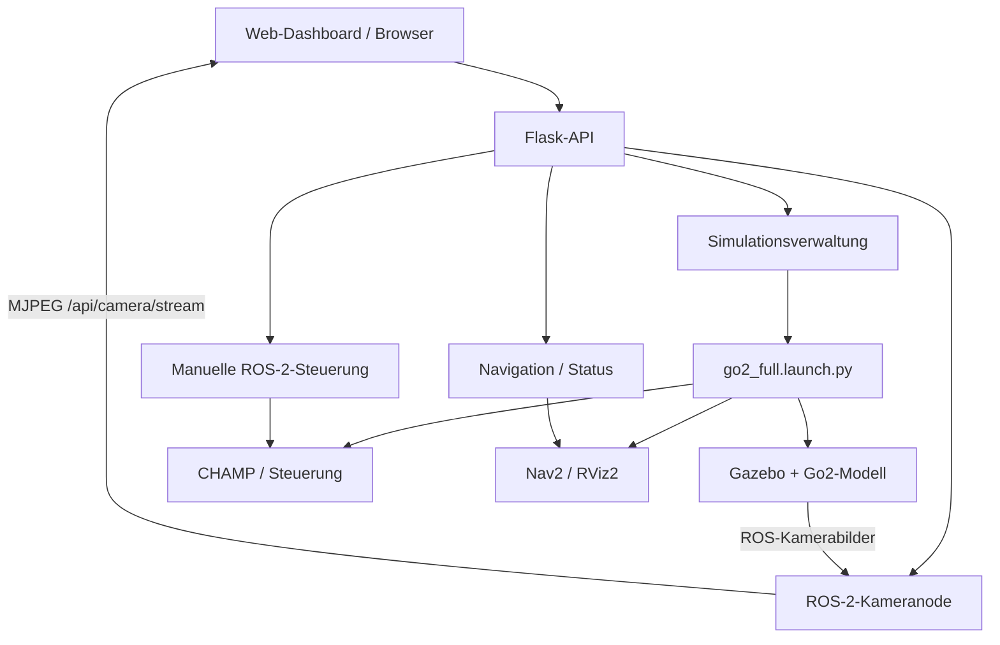

# Unitree Go2 – ROS 2 / Gazebo Simulation & Dashboard

Eine integrierte Simulations- und Steuerungsumgebung für den Quadruped-Roboter **Unitree Go2**. Das Projekt verbindet eine Gazebo-Simulation mit **ROS 2 Jazzy**, **CHAMP**, Navigationskomponenten und einem lokalen **Flask-Web-Dashboard**.

> **Projektstatus:** Aktiver Entwicklungsstand. Die Dokumentation beschreibt die bisher bestätigten Komponenten. Einzelne Start- und Installationsschritte hängen von externen CHAMP-Paketen und lokalen Workspaces ab.

## Inhaltsverzeichnis

- [Funktionsumfang](#funktionsumfang)
- [Technologien](#technologien)
- [Architektur](#architektur)
- [Repository-Struktur](#repository-struktur)
- [Voraussetzungen](#voraussetzungen)
- [Einrichtung und Start](#einrichtung-und-start)
- [Dashboard](#dashboard)
- [Bewegungssteuerung und CHAMP](#bewegungssteuerung-und-champ)
- [Navigation und Karten](#navigation-und-karten)
- [Entwicklungsverlauf](#entwicklungsverlauf)
- [Bekannte Einschränkungen](#bekannte-einschränkungen)
- [Weiterentwicklung](#weiterentwicklung)
- [Lizenz und Hinweise](#lizenz-und-hinweise)

## Funktionsumfang

- Simuliertes Unitree-Go2-Modell auf Basis von URDF/Xacro und Gazebo-Welten.
- ROS-2-basierte Steuerungs- und Integrationskomponenten.
- CHAMP-Anbindung mit konfigurierbaren Gangparametern (`champ_config/gait.yaml`).
- Manuelle Steuerung sowie Betriebsmodus- und Stop-Funktionen im Dashboard.
- Integration von Nav2, RViz2, SLAM-bezogenen Komponenten und gespeicherten Karten.
- Start und Stopp der Simulationssitzung über das Web-Dashboard.
- Gazebo-Kamerabild als MJPEG-Livestream im Browser.
- Automatische Aktivierung/Deaktivierung des Livebilds anhand des Simulationsstatus.
- Anzeige von Simulations- und Systemstatus.

## Technologien

| Bereich | Technologie |
| --- | --- |
| Betriebssystem (entwickelt auf) | Ubuntu 24.04.5 LTS |
| ROS-Distribution | ROS 2 Jazzy |
| Simulator | Gazebo Harmonic |
| Gangsteuerung | CHAMP |
| Navigation | Nav2 |
| Visualisierung | RViz2 |
| Dashboard | Python, Flask, HTML, CSS, JavaScript |
| Kameraverarbeitung | ROS `sensor_msgs/Image`, OpenCV, NumPy |
| Prozessverwaltung | Python `subprocess`, `psutil` |

## Architektur



Das Diagramm stellt die logische Integration vereinfacht dar; konkrete ROS-Topics und die genaue Launch-Reihenfolge sind im Quellcode definiert.

## Repository-Struktur

```text
unitree_go_integration/
├── champ_config/
│   └── gait.yaml
├── unitree_dashboard/
│   ├── app.py
│   ├── ros/
│   │   ├── camera.py
│   │   ├── manual_control.py
│   │   ├── navigation.py
│   │   ├── robot_status.py
│   │   └── simulation.py
│   ├── static/
│   │   ├── script.js
│   │   └── style.css
│   └── templates/
│       └── index.html
├── unitree_description/
│   ├── config/controllers.yaml
│   ├── launch/
│   ├── meshes/
│   ├── rviz/
│   ├── urdf/
│   └── worlds/
└── unitree_teleop/
    ├── config/
    ├── launch/
    ├── maps/
    ├── scripts/
    ├── src/
    └── unitree_teleop/
```

### Zentrale ROS-2-Pakete

**`unitree_description`** enthält die Go2-Beschreibung, Meshes, Sensor-/Roboter-Xacros, Gazebo-Welten und RViz-Konfigurationen.

**`unitree_teleop`** enthält Launchdateien und eigene Komponenten für Bewegungssteuerung, CHAMP-Adapter, Steuerquellen-Koordination, Odometrie-/TF-Brücken, Navigation und Visualisierung.

**`champ_config`** enthält die angepassten Gangparameter.

**`unitree_dashboard`** ist eine lokale Flask-Anwendung, die ROS-2-Nodes und HTTP-Endpunkte für Steuerung, Status und Kamera kombiniert.

## Voraussetzungen

Bestätigte Entwicklungsumgebung:

- Ubuntu 24.04 und ROS 2 Jazzy
- Gazebo Harmonic und passende ROS-Gazebo-Integration
- CHAMP-Pakete (u. a. `champ`, `champ_base`, `champ_msgs`)
- Nav2 und RViz2
- Python-Pakete `flask`, `psutil`, `opencv-python` bzw. systemseitiges `cv2`, `numpy`
- ROS-2-Nachrichtenpakete wie `geometry_msgs`, `sensor_msgs`, `std_msgs`, `nav2_msgs`, `trajectory_msgs`, `tf2_ros`

Die genaue Liste aller Systempakete ist noch nicht als reproduzierbares Installationsskript im Repository hinterlegt. Die `package.xml`-Dateien dokumentieren nur einen Teil der zur Laufzeit benötigten Abhängigkeiten.

### Verwendete Workspaces

Die aktuelle Dashboard-Startfunktion lädt standardmäßig:

```bash
source /opt/ros/jazzy/setup.bash
source ~/champ_ws/install/setup.bash
source ~/ros2_integration_ws/install/setup.bash
```

Diese Pfade können für den Dashboard-Start über `ROS_SETUP`, `CHAMP_SETUP` und `INTEGRATION_SETUP` angepasst werden. Die ältere Anleitung `unitree_teleop/README_CHAMP.md` verwendet teilweise `~/ros2_ws` und beschreibt einen früheren Startablauf.

## Einrichtung und Start

### 1. Repository beziehen

```bash
git clone https://github.com/samuhaug/unitree_go_simulation.git ~/unitree_go_integration
cd ~/unitree_go_integration
```

> Das Klonen allein reicht noch nicht für einen lauffähigen Build: CHAMP, ROS-2-Abhängigkeiten und die Workspace-Einbindung müssen eingerichtet sein.

### 2. ROS-2-Umgebung laden

```bash
source /opt/ros/jazzy/setup.bash
source ~/champ_ws/install/setup.bash
source ~/ros2_integration_ws/install/setup.bash
```

### 3. Gesamtsimulation starten

Bei korrekt installierten und gebauten Paketen:

```bash
ros2 launch unitree_teleop go2_full.launch.py
```

Die Dashboard-Funktion zum Starten der Simulation ruft denselben Launch-Befehl auf.

### 4. Dashboard starten

In einem Terminal mit eingerichteter ROS-2-/Python-Umgebung:

```bash
cd ~/unitree_go_integration
python3 unitree_dashboard/app.py
```

Anschließend im Browser öffnen: **http://127.0.0.1:5000**.

Der Webserver bindet im aktuellen Quellcode ausschließlich an `127.0.0.1` und ist damit standardmäßig nur lokal erreichbar.

> **Hinweis zur Reihenfolge:** Das Dashboard kann vor Gazebo gestartet werden. Der Simulationsstart erfolgt dann über die Schaltfläche im Dashboard.

## Dashboard

Das Dashboard stellt eine zentrale Oberfläche zur Verfügung, um Simulation und Steuerung zusammenzuführen.

### Simulationsmanagement

- Start über `POST /api/simulation/start`.
- Statusabfrage über `GET /api/simulation`.
- Beenden über `POST /api/simulation/stop`.
- Beim Stoppen werden zunächst Bewegungs- und Navigationsbefehle gestoppt; anschließend wird die Simulationssitzung beendet.

### Livebild

Der Kamerastream wird über `GET /api/camera/stream` als MJPEG bereitgestellt. Die Browseroberfläche verbindet sich **erst dann**, wenn die Simulation als laufend erkannt wird:

1. Simulation gestoppt: **„Simulation nicht gestartet“**; kein aktives `img.src`.
2. Simulation gestartet: **„Warte auf Kamerabild …“**.
3. Kamerabilder verfügbar: Livebild erscheint automatisch.
4. Simulation gestoppt: `src` wird entfernt und die Anzeige zurückgesetzt.

Die Statusabfrage erfolgt derzeit alle drei Sekunden. Der Simulationsstatus basiert auf dem gestarteten ROS-2-Launchprozess, **nicht** auf einer unabhängigen Prüfung des Gazebo-Fensters. Das reine Schließen des Gazebo-Fensters kann deshalb anders wirken als das Beenden der vollständigen Simulationssitzung.

### Systemstatus

Der Systemstatus stellt Informationen zum Betrieb der Simulation bereit. Die Oberfläche befindet sich in `unitree_dashboard/templates/index.html`, das Verhalten in `unitree_dashboard/static/script.js`.

## Bewegungssteuerung und CHAMP

Die Steuerungsintegration wurde schrittweise aufgebaut und umfasst unter anderem:

- CHAMP-Launchdatei: `unitree_teleop/launch/champ.launch.py`
- Adapter: `unitree_teleop/unitree_teleop/champ_manual_adapter.py`
- Steuerquellen-Koordination: `unitree_teleop/unitree_teleop/control_mux.py`
- Gangparameter: `champ_config/gait.yaml`
- Manuelle Dashboard-Steuerung: `unitree_dashboard/ros/manual_control.py`

Im Entwicklungsverlauf wurden Vorwärts-/Rückwärtsbewegung, Drehung, seitliche Bewegung und das Bewegungsverhalten (u. a. Drift und Kurvenverhalten) angepasst. Konkrete Geschwindigkeitswerte sollten aus der jeweils aktuellen Konfiguration gelesen werden, da ältere Notizen veraltete Werte enthalten können.

Für den früheren WASD-basierten Aufbau siehe [`unitree_teleop/README_CHAMP.md`](unitree_teleop/README_CHAMP.md). Diese Anleitung ist als historische Zusatzdokumentation zu verstehen.

## Navigation und Karten

Das Repository enthält Nav2-/SLAM-Konfigurationen sowie gespeicherte Karten:

- `unitree_teleop/config/nav2_params.yaml`
- `unitree_teleop/config/slam_params.yaml`
- `unitree_teleop/maps/go2_map.yaml`
- `unitree_teleop/maps/go2_map_complete.yaml`
- `unitree_description/rviz/go2_navigation.rviz`

Zusätzlich sind Komponenten für Odometrie, TF, SLAM-Pose-Bridging und Footprint-Visualisierung vorhanden. Die konkrete Navigationskonfiguration wird über die Launchdateien festgelegt.

## Entwicklungsverlauf

Die folgenden Phasen sind aus dem verfügbaren Projektverlauf und der aktuellen Verzeichnisstruktur rekonstruierbar. Sie stellen **keine vollständig datierte Commit-Historie** dar.

| Phase | Entwicklung |
| --- | --- |
| 1 | Aufbau der ROS-2-/Gazebo-Simulation und Einbindung des Go2-Modells. |
| 2 | Einrichtung von CHAMP und der ersten WASD-/Teleoperationssteuerung. |
| 3 | Entwicklung eigener Steueradapter und Anpassung von Gangparametern. |
| 4 | Verbesserung von Bewegungsrichtungen, seitlicher Bewegung und Driftverhalten. |
| 5 | Integration von Navigation, Karten, SLAM-bezogenen Brücken und RViz2. |
| 6 | Entwicklung des Flask-Dashboards mit Betriebsmodi und Systemstatus. |
| 7 | Zentraler Start/Stopp der vollständigen Simulationssitzung. |
| 8 | Einbindung der Gazebo-Kamera als MJPEG-Livebild. |
| 9 | Automatisches Starten/Stoppen des Livebilds anhand des Simulationsstatus. |

## Bekannte Einschränkungen

- Die Simulationsstatus-Erkennung überwacht den Launchprozess und nicht separat die Gazebo-GUI.
- Der Kamerastream ist an die Verfügbarkeit von ROS-Kamerabildern gebunden.
- Die Installationsschritte sind noch nicht vollständig automatisiert oder auf einem frischen System verifiziert.
- Die ältere CHAMP-Anleitung und die aktuelle Dashboard-Konfiguration verwenden teilweise unterschiedliche Workspace-Pfade.
- Die Paketmetadaten enthalten noch `TODO`-Angaben, insbesondere bei Lizenz und Beschreibung.
- Das Dashboard ist aktuell für den lokalen Einsatz konfiguriert; es besitzt keine hier dokumentierte Authentifizierung für eine Netzwerkfreigabe.

## Weiterentwicklung

Mögliche nächste Schritte:

- Direkte Überwachung des Gazebo-Prozesses zusätzlich zum Launchprozess.
- Reproduzierbare Installationsanleitung mit vollständiger Abhängigkeitsliste.
- Screenshots des Dashboards und der Gazebo-Simulation.
- Dokumentation der ROS-Topics, Actions und Betriebsmodi.
- Automatisierte Tests für Steuerung und Dashboard.
- Vereinheitlichung der Workspace-Pfade und Aktualisierung der CHAMP-Zusatzdokumentation.

## Lizenz und Hinweise

**Lizenzstatus:** In den derzeitigen `package.xml`-Dateien steht noch `TODO: License declaration`. Vor einer Lizenzangabe oder Veröffentlichung als Open-Source-Projekt muss eine passende Lizenz festgelegt und die Nutzung externer Modelle, Meshes und CHAMP-Komponenten geprüft werden.

Dieses Projekt dokumentiert eine **Simulations- und Entwicklungsumgebung**; Aussagen über die Sicherheit oder Einsatzfähigkeit auf realer Hardware sind damit nicht verbunden.

---

**Repository:** [samuhaug/unitree_go_simulation](https://github.com/samuhaug/unitree_go_simulation)
