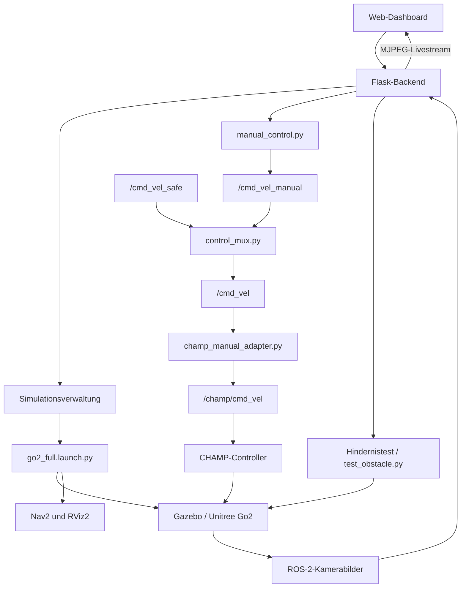

# Unitree Go2 – ROS 2 / Gazebo Simulation & Dashboard

Dieses Projekt entwickelt eine integrierte Simulations- und Steuerungsumgebung für den vierbeinigen Roboter **Unitree Go2**. Ziel ist es, die Bewegungssteuerung, Navigation und Sensorverarbeitung in einer virtuellen Umgebung zu erproben und über eine zentrale Benutzeroberfläche zugänglich zu machen.

Die technische Grundlage bilden **ROS 2 Jazzy**, **Gazebo Harmonic** und **CHAMP**. Ergänzend werden **Nav2** zur Navigation und **RViz2** zur Visualisierung eingesetzt.

Ein eigens entwickeltes **Flask-Web-Dashboard** ermöglicht die manuelle Robotersteuerung, das Starten und Beenden der Simulation, die Anzeige des Kamerabildes sowie das Platzieren und Entfernen von Testhindernissen.

Der Schwerpunkt liegt auf der Integration der Softwarekomponenten, der Entwicklung eigener Steuerungsfunktionen und der schrittweisen Verbesserung des Bewegungsverhaltens.

> **Projektstatus:** Das Projekt ist abgeschlossen. Die entwickelte Simulationsumgebung verbindet Gazebo, ROS 2, CHAMP, Navigation und das Web-Dashboard zu einem gemeinsamen System.

## Inhaltsverzeichnis

- [Funktionsumfang](#funktionsumfang)
- [Technologien](#technologien)
- [Architektur](#architektur)
- [Repository-Struktur](#repository-struktur)
- [Voraussetzungen](#voraussetzungen)
- [Einrichtung und Start](#einrichtung-und-start)
- [Dashboard](#dashboard)
- [Bewegungssteuerung und CHAMP](#bewegungssteuerung-und-champ)
- [Navigation und Karten](#navigation-und-karten)
- [Entwicklungsverlauf](#entwicklungsverlauf)
- [Ergebnisse der Optimierung der Seitwärtsbewegung](#ergebnisse-der-optimierung-der-seitwärtsbewegung)
- [Lizenz und Hinweise](#lizenz-und-hinweise)

## Funktionsumfang

- Simuliertes Unitree-Go2-Modell auf Basis von URDF/Xacro und Gazebo-Welten.
- ROS-2-basierte Steuerungs- und Integrationskomponenten.
- CHAMP-Anbindung mit konfigurierbaren Gangparametern (`champ_config/gait.yaml`).
- Manuelle Steuerung sowie Betriebsmodus- und Stop-Funktionen im Dashboard.
- Integration von Nav2, RViz2, SLAM-bezogenen Komponenten und gespeicherten Karten.
- Start und Stopp der Simulationssitzung über das Web-Dashboard.
- Gazebo-Kamerabild als MJPEG-Livestream im Browser.
- Automatische Aktivierung/Deaktivierung des Livebilds anhand des Simulationsstatus.
- Anzeige von Simulations- und Systemstatus.
- Testhindernisse direkt im Dashboard platzieren und entfernen.
- Automatische Aktivierung der Hindernis-Buttons bei laufender Simulation.

## Technologien

| Bereich | Technologie |
| --- | --- |
| Betriebssystem (entwickelt auf) | Ubuntu 24.04.5 LTS |
| ROS-Distribution | ROS 2 Jazzy |
| Simulator | Gazebo Harmonic |
| Gangsteuerung | CHAMP |
| Navigation | Nav2 |
| Visualisierung | RViz2 |
| Dashboard | Python, Flask, HTML, CSS, JavaScript |
| Kameraverarbeitung | ROS `sensor_msgs/Image`, OpenCV, NumPy |
| Prozessverwaltung | Python `subprocess`, `psutil` |

## Architektur

Das System verbindet die browserbasierte Benutzeroberfläche mit einem Flask-Backend und mehreren ROS-2-Komponenten. Gazebo simuliert den Roboter und seine Umgebung; CHAMP ist für die Gangsteuerung zuständig. Nav2 und RViz2 ergänzen Navigation und Visualisierung.



### Verarbeitung der Steuerbefehle

Die manuelle Steuerung übermittelt Geschwindigkeitsbefehle vom Dashboard an `manual_control.py`. Diese Komponente veröffentlicht auf `/cmd_vel_manual`. Der `control_mux.py` koordiniert Steuerquellen, darunter `/cmd_vel_manual` und `/cmd_vel_safe`, und gibt die ausgewählten Befehle über `/cmd_vel` weiter.

Der `champ_manual_adapter.py` verarbeitet diese Vorgaben und veröffentlicht die für CHAMP bestimmten Befehle auf `/champ/cmd_vel`. Der CHAMP-Controller setzt sie in die Bewegungssteuerung des simulierten Roboters um.

Die Darstellung beschreibt den logischen Datenfluss. Die konkrete Aktivierung der Komponenten und ihre Startreihenfolge ergeben sich aus den Launch-Dateien.

## Repository-Struktur

```text
unitree_go_integration/
├── champ_config/
│   └── gait.yaml
├── unitree_dashboard/
│   ├── app.py
│   ├── ros/
│   │   ├── camera.py
│   │   ├── manual_control.py
│   │   ├── navigation.py
│   │   ├── robot_status.py
│   │   └── simulation.py
│   ├── static/
│   │   ├── script.js
│   │   └── style.css
│   └── templates/
│       └── index.html
├── unitree_description/
│   ├── config/controllers.yaml
│   ├── launch/
│   ├── meshes/
│   ├── rviz/
│   ├── urdf/
│   └── worlds/
└── unitree_teleop/
    ├── config/
    ├── launch/
    ├── maps/
    ├── scripts/
    ├── src/
    └── unitree_teleop/
```

### Zentrale ROS-2-Pakete

**`unitree_description`** enthält die Go2-Beschreibung, Meshes, Sensor-/Roboter-Xacros, Gazebo-Welten und RViz-Konfigurationen.

**`unitree_teleop`** enthält Launchdateien und eigene Komponenten für Bewegungssteuerung, CHAMP-Adapter, Steuerquellen-Koordination, Odometrie-/TF-Brücken, Navigation und Visualisierung.

**`champ_config`** enthält die angepassten Gangparameter.

**`unitree_dashboard`** ist eine lokale Flask-Anwendung, die ROS-2-Nodes und HTTP-Endpunkte für Steuerung, Status und Kamera kombiniert.

## Voraussetzungen

Bestätigte Entwicklungsumgebung:

- Ubuntu 24.04 und ROS 2 Jazzy
- Gazebo Harmonic und passende ROS-Gazebo-Integration
- CHAMP-Pakete (u. a. `champ`, `champ_base`, `champ_msgs`)
- Nav2 und RViz2
- Python-Pakete `flask`, `psutil`, `opencv-python` bzw. systemseitiges `cv2`, `numpy`
- ROS-2-Nachrichtenpakete wie `geometry_msgs`, `sensor_msgs`, `std_msgs`, `nav2_msgs`, `trajectory_msgs`, `tf2_ros`

Die Einrichtung setzt eine bereits installierte ROS-2-, Gazebo- und CHAMP-Umgebung voraus. Die nachfolgenden Befehle beziehen sich auf die verwendete Workspace-Struktur.

### Verwendete Workspaces

Die aktuelle Dashboard-Startfunktion lädt standardmäßig:

```bash
source /opt/ros/jazzy/setup.bash
source ~/champ_ws/install/setup.bash
source ~/ros2_integration_ws/install/setup.bash
```

Diese Pfade können für den Dashboard-Start über `ROS_SETUP`, `CHAMP_SETUP` und `INTEGRATION_SETUP` angepasst werden. Die ältere Anleitung `unitree_teleop/README_CHAMP.md` verwendet teilweise `~/ros2_ws` und beschreibt einen früheren Startablauf.

## Einrichtung und Start

### 1. Repository beziehen

```bash
git clone https://github.com/samuhaug/unitree_go_simulation.git ~/unitree_go_integration
cd ~/unitree_go_integration
```

> Das Klonen allein reicht noch nicht für einen lauffähigen Build: CHAMP, ROS-2-Abhängigkeiten und die Workspace-Einbindung müssen eingerichtet sein.

### 2. ROS-2-Umgebung laden

```bash
source /opt/ros/jazzy/setup.bash
source ~/champ_ws/install/setup.bash
source ~/ros2_integration_ws/install/setup.bash
```

### 3. Gesamtsimulation starten

Bei korrekt installierten und gebauten Paketen:

```bash
ros2 launch unitree_teleop go2_full.launch.py
```

Die Dashboard-Funktion zum Starten der Simulation ruft denselben Launch-Befehl auf.

### 4. Dashboard starten

In einem Terminal mit eingerichteter ROS-2-/Python-Umgebung:

```bash
cd ~/unitree_go_integration
python3 unitree_dashboard/app.py
```

Anschließend im Browser öffnen: **http://127.0.0.1:5000**.

Der Webserver bindet im aktuellen Quellcode ausschließlich an `127.0.0.1` und ist damit standardmäßig nur lokal erreichbar.

> **Hinweis zur Reihenfolge:** Das Dashboard kann vor Gazebo gestartet werden. Der Simulationsstart erfolgt dann über die Schaltfläche im Dashboard.

## Dashboard

Das Dashboard stellt eine zentrale Oberfläche zur Verfügung, um Simulation und Steuerung zusammenzuführen.

### Simulationsmanagement

- Start über `POST /api/simulation/start`.
- Statusabfrage über `GET /api/simulation`.
- Beenden über `POST /api/simulation/stop`.
- Beim Stoppen werden zunächst Bewegungs- und Navigationsbefehle gestoppt; anschließend wird die Simulationssitzung beendet.

### Livebild

Der Kamerastream wird über `GET /api/camera/stream` als MJPEG bereitgestellt. Die Browseroberfläche verbindet sich **erst dann**, wenn die Simulation als laufend erkannt wird:

1. Simulation gestoppt: **„Simulation nicht gestartet“**; kein aktives `img.src`.
2. Simulation gestartet: **„Warte auf Kamerabild …“**.
3. Kamerabilder verfügbar: Livebild erscheint automatisch.
4. Simulation gestoppt: `src` wird entfernt und die Anzeige zurückgesetzt.

Die Statusabfrage erfolgt derzeit alle drei Sekunden. Der Simulationsstatus basiert auf dem gestarteten ROS-2-Launchprozess, **nicht** auf einer unabhängigen Prüfung des Gazebo-Fensters. Das reine Schließen des Gazebo-Fensters kann deshalb anders wirken als das Beenden der vollständigen Simulationssitzung.

### Hindernistest in Gazebo

Im Dashboard befindet sich im Reiter **Steuerung** unterhalb der
Geschwindigkeitseinstellungen die Karte **„Hindernistest – Gazebo“**.

Über zwei Buttons lässt sich ein Testhindernis in der Gazebo-Welt
`go2_world` verwalten:

1. **Simulation starten:** Gazebo über das Dashboard starten und warten,
   bis die Simulation läuft.
2. **Hindernis platzieren:** Auf **„🧱 Hindernis platzieren“** klicken.
   Ein Testhindernis wird in der Simulationswelt erzeugt.
3. **Hindernis entfernen:** Auf **„🗑️ Hindernis entfernen“** klicken.
   Das Testhindernis wird aus der Welt entfernt.

Die Buttons sind bei gestoppter Simulation deaktiviert. Während eine
Hindernisaktion ausgeführt wird, werden weitere Klicks vorübergehend
gesperrt. Das Dashboard zeigt den Status der Aktion an.

**Technische Umsetzung:**

- Flask-Endpunkte: `POST /api/obstacle/spawn` und
  `POST /api/obstacle/clear`
- Backend: `unitree_dashboard/app.py`
- Browsersteuerung: `unitree_dashboard/static/script.js`
- ROS-2-Programm: `unitree_teleop/unitree_teleop/test_obstacle.py`
- Aufruf: `ros2 run unitree_teleop test_obstacle spawn` beziehungsweise
  `ros2 run unitree_teleop test_obstacle clear`
- Gazebo-Welt: `go2_world`
- Hindernisname: `nav_demo_barrier`

Beim Entfernen versucht das ROS-2-Programm zusätzlich, die lokalen und
globalen Nav2-Costmaps zu leeren. Falls das nicht gelingt, können
Warnungen auftreten.

Die Hindernissteuerung dient zum Testen und Demonstrieren der
Hindernisvermeidung innerhalb der Simulation.

### Systemstatus

Der Systemstatus stellt Informationen zum Betrieb der Simulation bereit. Die Oberfläche befindet sich in `unitree_dashboard/templates/index.html`, das Verhalten in `unitree_dashboard/static/script.js`.

## Bewegungssteuerung und CHAMP

Die Bewegungssteuerung wurde schrittweise entwickelt und angepasst. Für die manuelle Bedienung im Dashboard stehen folgende Richtungen zur Verfügung:

| Taste | Funktion |
| --- | --- |
| `W` | Vorwärtsbewegung |
| `S` | Rückwärtsbewegung |
| `A` | Drehung nach links |
| `D` | Drehung nach rechts |
| `Q` | Seitwärtsbewegung nach links |
| `E` | Seitwärtsbewegung nach rechts |

### Anpassung der Drehbewegung mit A und D

Die Tasten **A** und **D** steuern die Drehung des Roboters um seine Hochachse: A nach links, D nach rechts. Im Zuge der Abstimmung der manuellen Bewegungssteuerung wurden die Drehbewegungen gemeinsam mit den übrigen Bewegungsrichtungen überprüft und das Kurven- beziehungsweise Drehverhalten angepasst. Die Drehbefehle durchlaufen dieselbe ROS-2-Verarbeitungskette wie die anderen manuellen Bewegungsbefehle: `manual_control.py` → `/cmd_vel_manual` → `control_mux.py` → `/cmd_vel` → `champ_manual_adapter.py` → `/champ/cmd_vel` → CHAMP.

Bei der Optimierung der Seitwärtsbewegung über **Q/E** wurde die zusätzliche automatische Drehkorrektur deaktiviert (`SIDEWAYS_YAW_MAX = 0.0`). Diese Änderung betrifft die Seitwärtsbewegung; **die gezielte Drehung über A/D bleibt weiterhin möglich**. Dadurch sind seitliche Bewegung und bewusst ausgelöste Drehung in der Steuerung klar voneinander getrennt.

Die Steuerung nutzt die ROS-2-Komponenten `manual_control.py`, `control_mux.py` und `champ_manual_adapter.py`. Ihre Aufgaben und Topics sind im Architekturabschnitt dargestellt.

Wichtige Dateien sind `unitree_teleop/launch/champ.launch.py`, `unitree_teleop/unitree_teleop/champ_manual_adapter.py`, `unitree_teleop/unitree_teleop/control_mux.py`, `unitree_dashboard/ros/manual_control.py` sowie `champ_config/gait.yaml`.

Die verwendeten Gangparameter und Geschwindigkeitsgrenzen sind in den Konfigurations- und Steuerungsdateien hinterlegt.

Die historische Zusatzanleitung [`unitree_teleop/README_CHAMP.md`](unitree_teleop/README_CHAMP.md) beschreibt einen früheren Aufbau und kann von den aktuellen Workspace-Pfaden abweichen.

## Navigation und Karten

Das Projekt enthält Nav2-Konfigurationen, SLAM-bezogene Komponenten und gespeicherte Karten. Nav2 unterstützt die Navigation auf einer vorhandenen Karte; RViz2 visualisiert unter anderem Robotermodell, Karten- und Navigationsdaten.

Wichtige Dateien sind:

- `unitree_teleop/config/nav2_params.yaml` – Parameter der Navigationskomponenten.
- `unitree_teleop/config/slam_params.yaml` – Konfiguration für SLAM-bezogene Funktionen.
- `unitree_teleop/maps/go2_map.yaml` und `go2_map_complete.yaml` – Metadaten gespeicherter Karten (mit zugehörigen Bilddateien).
- `unitree_description/rviz/go2_navigation.rviz` – RViz2-Konfiguration.

Im untersuchten `go2_full.launch.py` wird `go2_bringup.launch.py` mit `slam=False` und der Karte `go2_map_complete.yaml` eingebunden. Die Navigation sowie RViz2 und die Footprint-Visualisierung werden zeitverzögert gestartet. Ein Kamera-Bridge-Prozess wird separat eingebunden.

Beim regulären Gesamtstart wird eine vorhandene Karte geladen; die SLAM-Konfiguration ist separat im Repository enthalten.

## Entwicklungsverlauf

Die folgenden Phasen sind aus dem verfügbaren Projektverlauf und der aktuellen Verzeichnisstruktur rekonstruierbar. Sie stellen **keine vollständig datierte Commit-Historie** dar.

| Phase | Entwicklung |
| --- | --- |
| 1 | Aufbau der ROS-2-/Gazebo-Simulation und Einbindung des Go2-Modells. |
| 2 | Einrichtung von CHAMP und der ersten WASD-/Teleoperationssteuerung. |
| 3 | Entwicklung eigener Steueradapter und Anpassung von Gangparametern. |
| 4 | Verbesserung von Bewegungsrichtungen, seitlicher Bewegung und Driftverhalten. |
| 5 | Integration von Navigation, Karten, SLAM-bezogenen Brücken und RViz2. |
| 6 | Entwicklung des Flask-Dashboards mit Betriebsmodi und Systemstatus. |
| 7 | Zentraler Start/Stopp der vollständigen Simulationssitzung. |
| 8 | Einbindung der Gazebo-Kamera als MJPEG-Livebild. |
| 9 | Automatisches Starten/Stoppen des Livebilds anhand des Simulationsstatus. |
| 10 | Integration der Gazebo-Hindernissteuerung in das Dashboard mit Platzieren, Entfernen und Statusanzeige. |
| 11 | Untersuchung und Verbesserung der Seitwärtsbewegung über Q/E einschließlich Bewertung einer zusätzlichen Drehkorrektur. |

## Ergebnisse der Optimierung der Seitwärtsbewegung

### Ausgangsproblem
Bei der manuellen Seitwärtsbewegung über Q/E drehte sich der Unitree Go2 zunehmend um seine eigene Achse.

### Fehlersuche
- Untersuchung der ROS-2-Topics `/cmd_vel`, `/champ/cmd_vel` und `/odom`.
- Überprüfung möglicher Einflüsse der Navigations- und Sicherheitssteuerung.
- Analyse der Vorwärtsdrift und unerwünschter Drehbewegungen.
- Erprobung verschiedener Korrekturansätze, darunter ein winkelbasierter PD-Regler.

### Lösung
Die zusätzliche automatische Drehkorrektur verschlechterte das Seitwärtsverhalten.

Deshalb wurde im CHAMP-Adapter folgende Einstellung vorgenommen:

`SIDEWAYS_YAW_MAX = 0.0`

Die gezielte Drehsteuerung über A/D bleibt davon unabhängig aktiv (siehe „Anpassung der Drehbewegung mit A und D“).

### Ergebnis
- Deutlich geradlinigere Seitwärtsbewegung über Q/E.
- Wesentlich besser kontrollierbares Bewegungsverhalten.
- Geringe Restdrehung weiterhin vorhanden.

## Lizenz und Hinweise

**Lizenzhinweis:** In den vorhandenen `package.xml`-Dateien ist keine abschließend festgelegte Projektlizenz dokumentiert. Externe Komponenten unterliegen ihren jeweiligen Lizenzbedingungen.

Die dokumentierten Funktionen beziehen sich auf die Simulationsumgebung und nicht auf einen Einsatz am realen Roboter.

---

**Repository:** [samuhaug/unitree_go_simulation](https://github.com/samuhaug/unitree_go_simulation)
